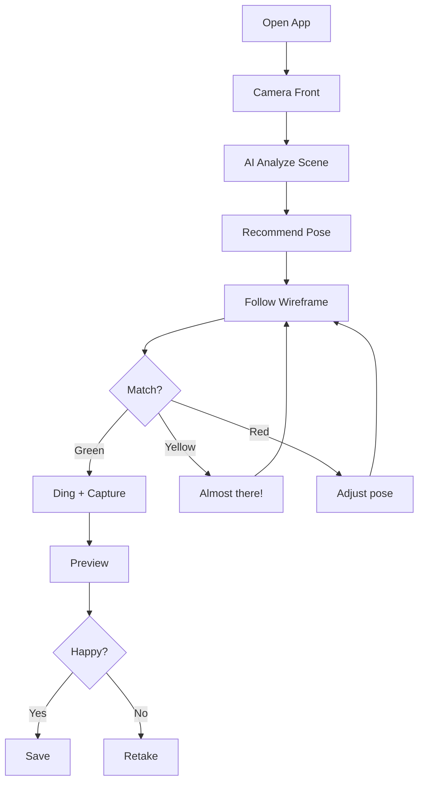

# UX Design Specification - ai-perfect-shot

**Author:** Z3tz3r0

---

## Executive Summary

### Project Vision

**ai-perfect-shot** เป็น Progressive Web App (PWA) ที่ทำหน้าที่เป็น **Real-time AI Photography Director** — แอปที่ให้คำแนะนำแบบ active ระหว่างการถ่ายภาพ โดย AI เข้าใจ scene และแนะนำ pose ที่เหมาะสมให้อัตโนมัติ

**Core Promise:** "ช่วยให้ทุกคนถ่ายรูปสวยได้ โดยไม่ต้องมีความรู้เรื่องการโพส"

**Differentiator:**

- **AI-Powered Pose Recommendation** — AI วิเคราะห์ scene + objects แล้วแนะนำ pose ที่เหมาะสม
- **Active Real-time Coaching** ผ่าน Forgiving Gradient Feedback (Red → Yellow → Green)
- **Smart Shutter** ที่ถ่ายอัตโนมัติเมื่อ pose match
- **Zero Data Egress** — ทั้งหมดประมวลผลบนเครื่องผู้ใช้ 100%

### Target Users

#### Primary Persona: "The Reluctant Photographer" (Joe)

- **Profile:** ชาย 21 ปี, นักศึกษา, มักถูกแฟน/เพื่อนขอให้ถ่ายรูปให้
- **Pain Point:** กลัวการถ่ายรูปเพราะมักถูกตำหนิ ("หัวโดนตัด!", "ทำไมขาดูสั้น?")
- **Need:** Tool ที่ช่วย guide ว่าต้องจัดกล้องยังไง โดยไม่ต้องมีความรู้เรื่อง composition
- **Context:** ใช้ back camera ถ่ายให้คนอื่น (Portrait mode)

#### Secondary Persona: "The Solo Selfie Queen" (Ping)

- **Profile:** หญิง 25 ปี, พนักงานออฟฟิศ, ชอบโพสต์ IG Story
- **Pain Point:** "ดูดีในกระจก แต่รูปออกมาแย่ทุกที"
- **Need:** Guidance ที่ช่วยให้ถ่าย selfie ได้สวยในครั้งเดียว
- **Context:** ใช้ front camera ถ่ายตัวเอง (Selfie mode)

#### User Mindset (Gen Z)

- ชอบ **Authenticity** มากกว่า over-edited perfection
- ต้องการ "Candid, Lo-Fi" aesthetic
- **30-Second Rule:** ถ้าไม่เห็น "Magic" ใน 30 วินาทีแรก = Uninstall

### Key Design Challenges

| #   | Challenge                      | Description                                                    | Impact                                      |
| --- | ------------------------------ | -------------------------------------------------------------- | ------------------------------------------- |
| 1   | **Judgment-Free Feedback**     | Red/Yellow/Green ต้องไม่ทำให้ user รู้สึกว่า "สอบตก"           | ต้อง design ให้เป็น coaching ไม่ใช่ grading |
| 2   | **Subject-Photographer Split** | Subject (คนถูกถ่าย) มองจอไม่เห็น แต่ต้องรู้ว่า pose match แล้ว | Audio/Haptic feedback ที่ clear และ timely  |
| 3   | **Info Density Management**    | Wireframe + Color + Text + Score อาจ overwhelming              | Progressive disclosure ที่ไม่รกจอ           |
| 4   | **First 30 Seconds**           | User ต้องเข้าใจและถ่ายรูปสำเร็จภายใน 30 วินาที                 | Minimal but effective onboarding            |
| 5   | **Graceful Degradation**       | เมื่อ AI ตรวจจับไม่ได้ (แสงไม่ดี, ไกลเกินไป)                   | Guide ไม่ใช่ error message                  |

### Design Opportunities

| #   | Opportunity                    | Description                                             | Expected Impact                   |
| --- | ------------------------------ | ------------------------------------------------------- | --------------------------------- |
| 1   | **"Forgiving Gradient" UX**    | ใช้ gradient feedback ให้ทุก pose รู้สึก "almost there" | ลด anxiety, เพิ่ม engagement      |
| 2   | **"Ding Moment" Celebration**  | Pose match = rewarding sound + visual                   | สร้าง positive reinforcement loop |
| 3   | **"Coach Voice" Persona**      | Text prompts ที่ friendly และ encouraging               | สร้าง emotional connection        |
| 4   | **"Invisible UI" Camera Mode** | UI หายไปเมื่อ user อยู่ใน flow                          | Immersive experience              |
| 5   | **"AI Director" Experience**   | AI แนะนำ pose ให้ ไม่ต้องเลือกเอง                       | Zero decision fatigue             |

---

## Design Foundations

### UX Principles

1. **Coaching, Not Judging** — Feedback ต้องรู้สึกเหมือนเพื่อนช่วยแนะนำ ไม่ใช่ระบบให้คะแนน
2. **No User Lockout** — Manual override ต้องเข้าถึงได้เสมอ ไม่เคย block user จากการถ่ายภาพ
3. **Progressive Disclosure** — แสดงข้อมูลเท่าที่จำเป็นในแต่ละ moment
4. **Celebrate Success** — ทุก pose match ต้องรู้สึก rewarding
5. **Privacy by Design** — ทุกอย่างเกิดขึ้นบน device ไม่มีข้อมูลหลุดออกไป
6. **Abstract Away Decisions** — AI ตัดสินใจแทน user ให้มากที่สุด เหลือแค่ที่จำเป็นจริงๆ

### Design Decisions (Confirmed)

| Decision               | Choice                           | Rationale                                                                                                          |
| ---------------------- | -------------------------------- | ------------------------------------------------------------------------------------------------------------------ |
| **Tone of Voice**      | Casual/Fun                       | "ดีมาก! เอียงหน้าอีกนิดนะ" — friendly coach persona                                                                |
| **Color Scheme**       | Dark Mode + Vibrant Accents      | Matches Gen Z "Flash Look" aesthetic trend; dark background ทำให้ wireframe เด่นชัด; pro-feel without being boring |
| **Wireframe Style**    | Skeleton (Clear/Visible)         | ชัดเจน ผู้ใช้เห็นง่ายว่าต้องทำอะไร                                                                                 |
| **Primary Use Case**   | Portrait Mode (Back Camera)      | Joe ถ่ายให้ Mint — optimize for photographer experience first                                                      |
| **Secondary Use Case** | Selfie Mode (Front Camera)       | Ping ถ่ายตัวเอง — support but not primary focus                                                                    |
| **Pose Selection**     | AI Recommends (not user gallery) | Zero decision fatigue — AI เลือกให้ user แค่ follow หรือ tap 'Next'                                                |
| **Pose Explanation**   | Show name + action hint          | เช่น "Confident Sit" + "Lean back, arm on armrest"                                                                 |

### Performance Constraints (Technical)

| Constraint          | Target                                 | Impact on UX              |
| ------------------- | -------------------------------------- | ------------------------- |
| Pose Detection FPS  | 30 FPS (flagship) / 15 FPS (mid-range) | Smooth feedback animation |
| Feedback Latency    | < 100ms                                | Real-time feel            |
| Time to Interactive | < 3 seconds                            | First impression          |
| Memory Usage        | < 300MB                                | No device sluggishness    |

---

## Core User Experience

### Core Experience Philosophy

> **"AI abstracts away decisions — user never thinks 'which pose?' They only follow guidance or tap 'Next' for alternatives."**

The app acts as an **AI Photography Director**, not just a pose matcher. It understands the scene, detects usable props, and recommends contextually appropriate poses.

### Defining Experience

**Core Loop:**

```
[Open App] → [AI analyzes scene + objects] → [AI recommends pose] → [User follows wireframe] → [Red→Yellow→Green] → [Ding! + Auto-capture] → [Preview] → [Save/Retake]
```

**Critical Actions:**

1. **Scene Understanding** — AI วิเคราะห์ว่าอยู่ที่ไหน มี props อะไรใช้ได้
2. **Pose Recommendation** — AI เลือก pose ที่เหมาะกับ scene + props
3. **Pose Matching Feedback** — แสดงว่า pose ปัจจุบันห่างจาก target เท่าไหร่
4. **Sequential Corrections** — บอกทีละอย่าง ไม่ overwhelming

**User Override:**

- **'Next Pose' Button** — ถ้าไม่ชอบ pose ที่ AI แนะนำ
- **Manual Shutter** — ถ่ายได้ทันทีไม่ต้องรอ match

### Platform Strategy

| Aspect           | Decision                                             |
| ---------------- | ---------------------------------------------------- |
| Type             | PWA (Progressive Web App)                            |
| Primary Devices  | Mobile (iOS Safari 15.4+, Android Chrome 90+)        |
| Orientation      | Portrait only (locked)                               |
| Input            | Touch-based                                          |
| Offline          | App shell cached; camera requires HTTPS              |
| Core Permissions | Camera (mandatory), Vibration & Audio (nice-to-have) |

### AI Architecture (MVP)

**On-Device AI Stack:**

| Component                      | Purpose                          | Model                              |
| ------------------------------ | -------------------------------- | ---------------------------------- |
| **Pose Detection**             | Detect body landmarks            | MediaPipe Pose Landmarker          |
| **Object Detection**           | Detect props (chair, sofa, etc.) | MediaPipe Object Detection (~5MB)  |
| **Scene Classification**       | Classify scene type              | MobileNet-based classifier (~15MB) |
| **Pose Recommendation Engine** | Match scene + props → best pose  | Rule-based + pose library          |

**Total Model Size:** ~20-25MB (acceptable for web)
**FPS Impact:** 30 FPS → ~22-25 FPS (still smooth)

### MVP Context: Professional/Event Setting

**Target Scenarios:**

- ออกบูธ (Booth events)
- ขึ้นเวที pitch (Stage presentations)
- ถ่ายรูปงาน event (Corporate/professional events)

**Scene Types (MVP):**

| Scene                        | Props Detected | Example Poses                            |
| ---------------------------- | -------------- | ---------------------------------------- |
| **Solo Chair**               | Chair/Stool    | Seated confident, Lean back, Cross-leg   |
| **Sofa/Couch**               | Sofa           | Casual seated, Arm on backrest           |
| **Standing (No Props)**      | None           | Power stance, Hand in pocket, Stage pose |
| **Standing (with backdrop)** | Booth/Banner   | Presenter pose, Product point            |

**Pose Count:** ~12-16 poses (3-4 per scene type)

### Pose Explanation UX

**Format:**

```
[Pose Name]
[Action Hint]
```

**Examples:**

- _'Confident Sit'_ + _'Lean back slightly, arm on armrest'_
- _'Stage Power'_ + _'Shoulders back, chin up'_
- _'Casual Chair'_ + _'Cross your legs, relax shoulders'_

**Display:** Text overlay on camera screen — casual/fun tone

### Effortless Interactions

| Interaction            | Design Goal                                    |
| ---------------------- | ---------------------------------------------- |
| Camera Permission      | Friendly explanation → one tap                 |
| Pose Selection         | **None** — AI recommends automatically         |
| Pose Override          | 'Next Pose' button → AI suggests another       |
| Feedback Understanding | Color-coded (Red/Yellow/Green) = universal     |
| Photo Capture          | Auto-capture on match OR visible manual button |
| Photo Save             | Preview → Save/Retake → Back to camera         |

### Critical Success Moments

| Moment                | Why Critical                       | UX Requirement                          |
| --------------------- | ---------------------------------- | --------------------------------------- |
| **First Match**       | Proves the concept works           | Must feel rewarding (Ding + Green glow) |
| **First Saved Photo** | Validates the result               | Photo must look noticeably better       |
| **Subject Feedback**  | Bridges photographer-subject split | Haptic + audio clear enough to freeze   |
| **Override Trust**    | Builds user confidence             | Never feel like a fallback              |
| **Edge Recovery**     | Prevents frustration               | Helpful guidance, not error messages    |
| **Scene Recognition** | Shows AI "gets it"                 | Pose matches the environment naturally  |

### Experience Principles

1. **Feedback First** — ทุก action มี immediate visual feedback
2. **Progressive Confidence** — Guide จาก Red ไป Green ไม่ใช่แค่บอกว่า "ผิด"
3. **Dual-Channel Output** — ข้อมูลสำคัญมี 2 ช่องทาง (Visual + Audio/Haptic)
4. **Always an Exit** — Manual override เข้าถึงได้เสมอ
5. **Celebrate, Don't Grade** — Ding + glow ไม่ใช่ score display
6. **One Thing at a Time** — ไม่ให้ 3 corrective actions พร้อมกัน (Sequential corrections)
7. **AI Decides, User Follows** — ลด decision fatigue ให้น้อยที่สุด

### Post-Capture Flow

**Standard Camera UX:**

```
[Capture] → [Preview Screen] → [Save / Retake] → [Back to Camera]
```

**MVP Scope:**

- ✅ Preview screen with captured photo
- ✅ Save to Camera Roll button
- ✅ Retake button
- ❌ Post-capture badge/validation (deferred to v2)

---

## Desired Emotional Response

### Primary Emotional Goals

1. **Confidence over Anxiety** — User ต้องรู้สึกมั่นใจตั้งแต่เปิด app ว่า AI จะช่วยเอง ไม่ต้องกังวล
2. **Coached, Not Judged** — User รู้สึกเหมือนมีเพื่อนช่วยแนะนำ ไม่ใช่ถูกตัดสิน
3. **Accomplishment + Surprise** — เมื่อสำเร็จ user ภูมิใจและประหลาดใจว่ารูปดีกว่าที่คิด
4. **In Control, Never Trapped** — User ควบคุมได้เสมอ ไม่เคยถูก lock out

### Emotional Journey Mapping

| Stage             | Before       | After              | How                                |
| ----------------- | ------------ | ------------------ | ---------------------------------- |
| Open App          | Nervous      | Curious, reassured | Friendly UI, quick onboarding      |
| Camera Permission | Suspicious   | Trusted            | Clear explanation                  |
| See Wireframe     | Confused     | "I get it!"        | Immediate visual guidance          |
| Follow Wireframe  | Focused      | Engaged, playful   | Forgiving gradient, casual prompts |
| Green Match       | Anticipation | Delight            | Ding! + Green glow celebration     |
| See Preview       | Hope         | Pleasant surprise  | Photo looks better                 |
| Save              | Satisfaction | Pride              | Instant save, clean flow           |
| Edge Cases        | Frustration  | Guided             | "Step closer" not "Error"          |

### Micro-Emotions

**Pursue:**

- ✅ Confidence, Trust, Accomplishment, Delight, Empowerment, Playfulness

**Avoid:**

- ❌ Anxiety, Suspicion, Frustration, Boredom, Helplessness, Pressure

### Design Implications

| Emotion        | UX Design                                              |
| -------------- | ------------------------------------------------------ |
| Confidence     | AI recommends (no decision paralysis), dark pro UI     |
| Coached        | Casual/fun prompts, pose explanations with personality |
| Not Judged     | Gradient feedback (never "fail"), celebrate Green      |
| Accomplishment | Ding + Green glow + haptic on match                    |
| Surprise       | Preview shows automatically good composition           |
| In Control     | Manual shutter always visible, 'Next Pose' available   |
| Playfulness    | Pose names + action hints add personality              |
| Trust          | No login, no cloud, immediate value                    |

### Emotional Design Principles

1. **Reframe Negative to Positive** — Red ไม่ใช่ "wrong" แต่เป็น "not yet there"
2. **Celebrate Every Success** — Pose match = celebration moment (Ding + Glow)
3. **Personality in Prompts** — Text ต้องมี personality ไม่ใช่ clinical
4. **Always an Exit** — ไม่เคยทำให้ user รู้สึก trapped
5. **Immediate Value** — ไม่มี signup, ไม่มี tutorial บังคับ, value ภายใน 30 วินาที

---

## UX Pattern Analysis & Inspiration

### Inspiring Products Analysis

| Product           | Key UX Strength                              | Transferable Pattern                        |
| ----------------- | -------------------------------------------- | ------------------------------------------- |
| **BeReal**        | Authenticity-first, camera-opens-immediately | Camera-first launch, zero friction          |
| **VSCO**          | Dark UI, invisible controls, content-focused | Dark mode, minimal UI, camera dominates     |
| **Duolingo**      | Micro-celebrations, forgiving feedback       | Ding + glow on match, "Almost!" not "Wrong" |
| **Nike Run Club** | Real-time coaching, dual-channel feedback    | Visual + Audio + Haptic for subject         |
| **TikTok Camera** | Zero-to-result speed, real-time effects      | Instant preview, one-tap save               |

### Transferable UX Patterns

**Navigation:**

- Camera-first launch (no home screen)
- Minimal navigation (Shoot, Next Pose, Settings only)
- Invisible controls (fade when focusing)

**Interaction:**

- Micro-celebrations (Ding! + Green glow)
- Real-time guidance (wireframe moves with user)
- Dual-channel feedback (Visual + Audio + Haptic)
- One-tap save

**Visual:**

- Dark mode default (pro feel, wireframe pops)
- Content-dominant (camera preview 90%+ of screen)
- Glowing accents (vibrant feedback colors)

**Feedback:**

- Forgiving gradient (Red → Yellow → Green)
- Encouraging prompts (friendly tone)
- Celebration moment (sound + visual + haptic)

### Anti-Patterns to Avoid

| Avoid            | Why               | Solution               |
| ---------------- | ----------------- | ---------------------- |
| Tutorial walls   | Users bounce      | Instant camera access  |
| Login required   | Friction          | No login in MVP        |
| Gallery browsing | Decision fatigue  | AI recommends          |
| Score/percentage | Feels like a test | Celebrate, don't grade |
| Binary pass/fail | Creates anxiety   | Forgiving gradient     |
| Error modals     | Breaks flow       | Inline guidance        |

### Design Inspiration Strategy

**Adopt Directly:**

- Dark UI + vibrant accents (VSCO)
- Camera-first launch (BeReal/TikTok)
- Micro-celebration sounds (Duolingo)
- Real-time overlay (standard camera UX)

**Adapt for ai-perfect-shot:**

- Audio coaching → for Subject only (NRC pattern modified)
- Progress indication → color gradient instead of percentage
- Gamification → defer to v2

**Avoid Explicitly:**

- Login walls, tutorial screens, gallery browsing, score displays, complex settings

---

## Design System Foundation

### Design System Choice — Validated via Comparative Analysis

**Selected:** Tailwind CSS + Shadcn/UI

**Comparative Analysis Results:**

| Option               | Weighted Score |
| -------------------- | -------------- |
| ✅ Tailwind + Shadcn | **9.50/10**    |
| Vanilla CSS          | 8.05/10        |
| Chakra UI            | 7.60/10        |
| Mantine              | 7.55/10        |
| MUI                  | 6.50/10        |

**Scoring Criteria (Weights):**

- Dark Mode Quality (20%) — Essential for Gen Z aesthetic
- Bundle Size (20%) — PWA performance target
- Camera App Flexibility (20%) — Custom overlays on video/canvas
- Development Speed (15%) — 3-5 week timeline
- Learning Curve (10%), Component Quality (10%), Community/Docs (5%)

**Why Tailwind + Shadcn Wins:**

- Perfect scores on Bundle Size, Camera Flexibility, Dark Mode
- Only imports what you use (no bloat)
- No opinionated layout that conflicts with camera UI
- Copy-paste components = fast development

### Component Strategy

**From Shadcn/UI (Pre-built):**

| Component | Usage                           |
| --------- | ------------------------------- |
| Button    | Shutter, Next Pose, Save/Retake |
| Sheet     | Settings drawer                 |
| Toast     | Pose prompts                    |
| Dialog    | Camera permission modal         |

**Custom Components (Build):**

| Component        | Why Custom                              |
| ---------------- | --------------------------------------- |
| Camera Preview   | Core — uses `<video>` + getUserMedia    |
| Wireframe Canvas | Core — WebGL overlay for pose skeleton  |
| Feedback Overlay | Core — Green/Yellow/Red glow animations |
| Pose Hint        | Core — pose name + action hint display  |

### Design Tokens

**Colors (Dark Mode):**

| Token              | Value   | Usage                  |
| ------------------ | ------- | ---------------------- |
| `--background`     | #0a0a0a | Main background        |
| `--surface`        | #1a1a1a | Cards, panels          |
| `--border`         | #2a2a2a | Subtle borders         |
| `--primary`        | #10b981 | Success/match (Green)  |
| `--warning`        | #f59e0b | Almost there (Yellow)  |
| `--destructive`    | #ef4444 | Needs adjustment (Red) |
| `--text-primary`   | #ffffff | Main text              |
| `--text-secondary` | #a1a1aa | Secondary text         |

**Typography:**

- Font: Inter (Google Fonts)
- Prompt text: 18px (1.125rem)
- Labels: 14px (0.875rem)

**Spacing:**

- Safe area: `env(safe-area-inset-bottom)` for iPhone
- Controls: 16px padding
- Screen edge: 24px margin

### Implementation Approach

1. Initialize Next.js with Tailwind CSS
2. Install Shadcn/UI CLI: `npx shadcn-ui@latest init`
3. Add only needed components: `npx shadcn-ui@latest add button sheet toast dialog`
4. Configure dark mode as default in tailwind.config.js
5. Create custom camera/overlay components
6. Define CSS variables in globals.css

### Risk Mitigation (Pre-mortem Analysis)

**Tailwind Hygiene:**

- [ ] Extract reusable components (no class soup)
- [ ] Use CSS variables for design tokens
- [ ] Use `cva()` for component variants

**Shadcn Integration:**

- [ ] Define z-index map (Camera=1, Wireframe=10, Controls=100, Modals=1000)
- [ ] Customize components for camera/dark context
- [ ] Test on real mobile devices before finalizing

**Dark Mode:**

- [ ] Force dark mode globally (`<html class="dark">`)
- [ ] Audit all components for dark variants
- [ ] Use only design token colors, no hardcoded values

**Performance:**

- [ ] Verify Tailwind purge config paths
- [ ] Tree-shake all imports (icons, components)
- [ ] Run bundle analyzer before deploy
- [ ] Only import: Button, Sheet, Toast, Dialog

**iOS Safari:**

- [ ] Test on real iPhone from day 1
- [ ] Avoid CSS transform on video elements
- [ ] Disable Shadcn transitions on camera overlays
- [ ] Add `will-change` hints for animations

---

## Defining User Experience

### The Defining Experience

**"AI tells you how to pose, then captures the perfect shot automatically"**

ภาษาไทย: "AI บอกท่าโพส แล้วถ่ายให้อัตโนมัติเมื่อพร้อม"

User อธิบายให้เพื่อนฟัง:

> "มันคือแอปที่ AI ดู scene แล้วบอกว่าต้องโพสยังไง พอโพสถูกปุ๊บมันก็ถ่ายให้เลย ไม่ต้องคิดอะไรเลย!"

### User Mental Model

**Current Pain Points:**

- Static samples → ต้องเทียบเอง ไม่รู้ว่าถูกหรือยัง
- Vague instructions → "ยืนตรงๆ" ไม่ชัดเจน
- Trial and error → ถ่าย 50 รูป ได้ 1 รูป
- No guidance → Camera freeze

**User Expectations → Our Response:**

| Expectation           | Response                          |
| --------------------- | --------------------------------- |
| "บอกฉันว่าต้องทำอะไร" | AI แนะนำ pose + action hint       |
| "รู้ว่าใกล้จะถูกแล้ว" | Color feedback (Red→Yellow→Green) |
| "ไม่ต้องคิดมาก"       | AI ตัดสินใจ pose ให้              |
| "ถ่ายให้เมื่อพร้อม"   | Smart Shutter auto-capture        |

### Success Criteria

| Criteria             | Target                          |
| -------------------- | ------------------------------- |
| Time to First Match  | < 30 seconds                    |
| Match Understanding  | 100% clear from color + prompts |
| Capture Satisfaction | "Better than usual" composition |
| Override Available   | Always (Manual + Next Pose)     |
| Subject Awareness    | Clear Ding + Haptic signal      |

**"This Just Works" Moments:**

1. เปิด app → เห็น camera ทันที (no login, no tutorial)
2. AI recommend pose → wireframe ปรากฏทันที
3. ขยับตามแล้ว → สีเปลี่ยนเป็น Green → Ding! → Auto-capture
4. ดู preview → "โอ้ ดีกว่าปกติ!" → Save!

### Novel UX Patterns

**Our Innovations:**

| Innovation                        | What's New                                      |
| --------------------------------- | ----------------------------------------------- |
| **AI Pose Recommendation**        | Scene analysis → automatic pose suggestion      |
| **Real-time Wireframe Overlay**   | Skeleton moves with user in real-time           |
| **Smart Shutter**                 | Auto-capture when pose matches                  |
| **Dual-Channel Subject Feedback** | Audio + Haptic for subject who can't see screen |

**Familiar Metaphor:**

> "Like a friend who's good at photography, telling you exactly what to do"

### Experience Mechanics

**1. Initiation:**

- Open app → Camera view opens immediately
- AI analyzes scene + objects (1-2 sec)
- Wireframe + Pose Name + Action Hint appear

**2. Interaction:**

- User sees wireframe: "Stage Power" + "Shoulders back, chin up"
- User adjusts body → Color: Red → Yellow
- User matches pose → Color: Yellow → Green
- User taps 'Next Pose' → New pose recommended

**3. Feedback:**

| State           | Visual             | Audio      | Haptic       |
| --------------- | ------------------ | ---------- | ------------ |
| Far from target | Red glow           | -          | -            |
| Getting close   | Yellow glow        | -          | -            |
| Match!          | Green glow + flash | "Ding!" 🔔 | Vibration 📳 |

**4. Completion:**

- Auto-capture → Preview screen
- Save/Retake buttons
- Return to camera for next shot

---

## Visual Design Foundation

### Color System

**Theme Philosophy:** "Pro Camera Feel with Playful Feedback"

**Base Colors (Dark Mode):**

| Token                | Hex     | Usage                    |
| -------------------- | ------- | ------------------------ |
| `--background`       | #0a0a0a | Main app background      |
| `--surface`          | #1a1a1a | Cards, panels, settings  |
| `--surface-elevated` | #242424 | Popups, overlays         |
| `--border`           | #2a2a2a | Subtle borders, dividers |

**Text Colors:**

| Token              | Hex     | Usage                |
| ------------------ | ------- | -------------------- |
| `--text-primary`   | #ffffff | Headings, pose names |
| `--text-secondary` | #a1a1aa | Action hints, labels |
| `--text-muted`     | #52525b | Disabled states      |

**Feedback Colors (Core UX):**

| Token                | Hex     | Name          | Usage            |
| -------------------- | ------- | ------------- | ---------------- |
| `--feedback-success` | #10b981 | Emerald Green | Pose match! ✓    |
| `--feedback-warning` | #f59e0b | Amber         | Almost there...  |
| `--feedback-error`   | #ef4444 | Rose Red      | Needs adjustment |

**Glow Effects (Camera Overlay):**

| Token            | CSS                                | Usage                |
| ---------------- | ---------------------------------- | -------------------- |
| `--glow-success` | `0 0 20px rgba(16, 185, 129, 0.5)` | Green match glow     |
| `--glow-warning` | `0 0 20px rgba(245, 158, 11, 0.5)` | Yellow progress glow |
| `--glow-error`   | `0 0 15px rgba(239, 68, 68, 0.4)`  | Subtle red glow      |

### Typography System

**Font:** Inter (Google Fonts) — Clean, modern, highly readable

**Type Scale:**

| Level              | Size            | Weight | Usage                                    |
| ------------------ | --------------- | ------ | ---------------------------------------- |
| `--font-pose-name` | 24px (1.5rem)   | 600    | Pose name: "Confident Sit"               |
| `--font-hint`      | 16px (1rem)     | 400    | Action hint: "Lean back, arm on armrest" |
| `--font-button`    | 14px (0.875rem) | 500    | Button labels                            |
| `--font-label`     | 12px (0.75rem)  | 400    | Small labels, settings                   |

**Font Loading:**

```html
<link
  href="https://fonts.googleapis.com/css2?family=Inter:wght@400;500;600&display=swap"
  rel="stylesheet"
/>
```

### Spacing & Layout

**Grid:** 8px base unit (all spacing multiples of 8px)

| Token       | Value | Usage            |
| ----------- | ----- | ---------------- |
| `--space-1` | 4px   | Subtle gaps      |
| `--space-2` | 8px   | Icon spacing     |
| `--space-3` | 12px  | Compact padding  |
| `--space-4` | 16px  | Standard padding |
| `--space-6` | 24px  | Section margins  |
| `--space-8` | 32px  | Large gaps       |

**Layout Zones:**

```
┌─────────────────────────────────────┐
│           SAFE AREA TOP             │ 48px
├─────────────────────────────────────┤
│          CAMERA PREVIEW             │ Flex fill
│     ┌───────────────────────┐       │
│     │   POSE HINT OVERLAY   │       │ 80px offset
│     └───────────────────────┘       │
├─────────────────────────────────────┤
│  [Next]    ⬤ SHUTTER      [Flip]   │ 100px controls
└─────────────────────────────────────┘
│         SAFE AREA BOTTOM            │ env(safe-area)
```

**Z-Index Map:**

| Layer         | Z-Index | Content                    |
| ------------- | ------- | -------------------------- |
| Camera Video  | 1       | Background video stream    |
| Wireframe     | 10      | AI skeleton overlay        |
| Feedback Glow | 20      | Color glow effects         |
| Pose Hint     | 50      | Text overlay               |
| Controls      | 100     | Shutter, Next Pose buttons |
| Modal         | 1000    | Settings, permissions      |

**Mobile Constraints:**

- Min touch target: 44x44px (iOS HIG)
- Shutter button: 64x64px (primary action)
- Edge margin: 24px
- Portrait orientation locked

### Accessibility

**Contrast Ratios (WCAG AA):**

| Pair                      | Ratio  | Pass   |
| ------------------------- | ------ | ------ |
| White on #0a0a0a          | 19.6:1 | ✅ AAA |
| #a1a1aa on #0a0a0a        | 7.4:1  | ✅ AAA |
| Green #10b981 on #0a0a0a  | 8.3:1  | ✅ AAA |
| Yellow #f59e0b on #0a0a0a | 6.8:1  | ✅ AA  |

**Multimodal Feedback:**
All critical feedback uses 2+ channels (Visual + Audio + Haptic)
No color-only signals for essential information

**Motion:**

```css
@media (prefers-reduced-motion: reduce) {
  * {
    animation-duration: 0.01ms !important;
  }
}
```

---

## Design Direction

### Chosen Direction: Hybrid Modern

**Philosophy:** Balance of professionalism and friendliness — modern, approachable, clear.

**Key Design Decisions:**

- Full-screen camera with no chrome
- Floating semi-transparent pose hint card (bottom center)
- Docked control bar with glass effect
- Medium wireframe strokes (3px) with animated color transitions
- Soft gradient glow effects, not harsh

### Layout Specification

**Camera Preview:** 100% viewport, no borders

**Pose Hint Card:** Semi-transparent (#1a1a1a/80), rounded-2xl, centered bottom

**Control Bar:** Fixed bottom, 80px height, blur backdrop

**Control Layout:**

```
┌─────────────────────────────────────┐
│         [CAMERA PREVIEW]            │
│     ┌───────────────────────┐       │
│     │ 🎭 Confident Sit       │       │
│     │ Lean back, arm on...  │       │
│     └───────────────────────┘       │
├─────────────────────────────────────┤
│  [⟳]      ⬤ SHUTTER        [📷]  │
│  Next        (64px)       Flip   │
└─────────────────────────────────────┘
```

### Component Styles

| Component             | Specification                                            |
| --------------------- | -------------------------------------------------------- |
| **Shutter Button**    | 64px white circle, scale 0.95 on press                   |
| **Secondary Buttons** | 44px, icon-only, rounded-full, #3f3f46                   |
| **Pose Name**         | Inter 600, 20px, white                                   |
| **Action Hint**       | Inter 400, 14px, #a1a1aa                                 |
| **Pose Card**         | Semi-transparent (#1a1a1a/80), rounded-2xl, 16px padding |

### Animation Specifications

| Animation        | Duration   | Effect                               |
| ---------------- | ---------- | ------------------------------------ |
| Color transition | 300ms      | ease-in-out between Red/Yellow/Green |
| Glow pulse       | continuous | Subtle when Yellow                   |
| Match flash      | 150ms      | White overlay on Green               |
| Shutter press    | 100ms      | Scale 0.95 → 1.0                     |
| Pose hint appear | 200ms      | Fade + slide up                      |

### Design Rationale

**Why Hybrid Modern:**

1. **Gen Z Appeal** — Modern aesthetic without being boring
2. **First-time Clarity** — Visible controls and pose hints
3. **Pro Feel** — Dark theme, clean, uncluttered
4. **Balanced Feedback** — Visible but not overwhelming
5. **Event-ready** — Suitable for professional booth/stage context

---

## User Journey Flows

### Journey 1: Solo Selfie (Ping)

**Persona:** Ping (25, Office Worker)
**Scenario:** ถ่าย selfie ที่ event สำหรับ IG Story

**Flow:**

1. Open app → Camera (front) opens immediately
2. AI detects scene → Recommends "Social Media Ready" pose
3. User follows wireframe → Color: Red → Yellow → Green
4. Green match → Ding! + Auto-capture
5. Preview → Save/Retake
6. Save → Back to camera

**Key Moment:** Ding + Green = Delight



### Journey 2: Reluctant Photographer (Joe → Mint)

**Persona:** Joe (21, Student) ถ่ายให้ Mint (แฟน)
**Scenario:** ถ่ายรูปให้ Mint ที่บูธ มีเก้าอี้

**Flow:**

1. Open app → Camera (back) opens
2. AI detects: Chair + 1 Person → Recommends "Confident Sit"
3. Joe sees wireframe → Gives verbal cues to Mint
4. Green match → Ding + Haptic → Mint freezes
5. Auto-capture → Joe shows Mint preview
6. Save → Both happy

**Key Moment:** Dual-channel feedback (Audio + Haptic) bridges Photographer-Subject split

**Subject Feedback:**

- Audio: "Ding!" 🔔 (Mint hears)
- Haptic: Vibration 📳 (Joe's phone, Mint may feel if close)
- Result: Mint knows to freeze without seeing screen

### Journey 3: Override Moment

**Scenario:** AI won't capture but user wants to shoot now

**Flow:**

1. Pose stuck at Yellow for 5+ seconds
2. User taps Manual Shutter (always visible)
3. Instant capture — no confirmation modal
4. Preview → Save/Retake

**Key Principle:** "Override is a feature, not a fallback"

**Design Decisions:**
| Decision | Rationale |
|----------|-----------||
| No confirmation modal | ไม่ทำให้ user รู้สึกว่า "ฝืน" AI |
| Shutter always visible | Not hidden, not dimmed |
| Instant capture | No delay, no judgment |
| Same preview flow | Consistent experience |

### Journey Patterns

**Navigation Patterns:**

- Camera-first (no home screen)
- Single-screen focus
- Preview → Decision loop

**Decision Patterns:**

- AI suggests, User confirms
- Binary post-capture (Save/Retake)
- Implicit continuation (after save, back to camera)

**Feedback Patterns:**

- Color gradient (Red → Yellow → Green)
- Dual-channel for Subject (Audio + Haptic)
- Sequential corrections (one at a time)
- Celebration on success (Ding + Glow + Flash)

---

## Component Strategy

### Design System Components (Shadcn/UI)

| Component | Usage                            |
| --------- | -------------------------------- |
| Button    | Shutter, Next Pose, Save, Retake |
| Sheet     | Settings drawer                  |
| Dialog    | Camera permission modal          |

### Custom Components

**1. CameraPreview**

- Purpose: Real-time camera feed
- Technology: `<video>` + getUserMedia API
- Props: `facingMode`, `onReady`, `onError`
- States: Loading, Active, Permission Denied, No Camera

**2. WireframeCanvas**

- Purpose: AI skeleton overlay on camera
- Technology: Canvas element (WebGL or 2D)
- Props: `landmarks`, `targetPose`, `matchScore`
- Visual: 3px stroke, color from matchScore
- Color Logic: score ≥ 0.9 = Green, ≥ 0.7 = Yellow, else Red

**3. FeedbackGlow**

- Purpose: Screen-edge glow for feedback
- Technology: CSS gradients + animations
- Props: `state: 'none' | 'far' | 'close' | 'match'`
- Animations: Yellow pulse, Green flash

**4. PoseHintCard**

- Purpose: Display pose name + action hint
- Visual: Semi-transparent (#1a1a1a/80), rounded-2xl
- Props: `poseName`, `actionHint`, `visible`
- Accessibility: `aria-live="polite"`

**5. ControlBar**

- Purpose: Bottom control bar with actions
- Layout: `[Next] [Shutter 64px] [Flip]`
- Visual: Fixed bottom, blur backdrop, 80px height
- Props: `onShutter`, `onNextPose`, `onFlipCamera`

**6. PreviewScreen**

- Purpose: Captured photo with Save/Retake
- Technology: Full-screen overlay
- Props: `imageUrl`, `onSave`, `onRetake`
- Accessibility: `role="dialog"`, focus trap

### Component Hierarchy

```
<App>
├── <CameraScreen>
│   ├── <CameraPreview />
│   ├── <WireframeCanvas />
│   ├── <FeedbackGlow />
│   ├── <PoseHintCard />
│   └── <ControlBar />
├── <PreviewScreen />
├── <PermissionDialog />
└── <SettingsSheet />
```

### Component Implementation Strategy

- Build custom components using Tailwind utility classes
- Use CSS variables for design tokens
- Follow Shadcn patterns for consistency
- Use `cva()` for component variants
- All components follow ARIA accessibility patterns

### Implementation Roadmap

| Phase       | Components                                  | Timeline |
| ----------- | ------------------------------------------- | -------- |
| **Phase 1** | CameraPreview, ControlBar, PreviewScreen    | Week 1-2 |
| **Phase 2** | WireframeCanvas, FeedbackGlow, PoseHintCard | Week 2-3 |
| **Phase 3** | PermissionDialog, SettingsSheet, Animations | Week 3-4 |

---

## UX Consistency Patterns

### Button Hierarchy

| Level         | Visual                         | Usage                  |
| ------------- | ------------------------------ | ---------------------- |
| **Primary**   | 64px White circle              | Shutter button         |
| **Secondary** | 44px #3f3f46 circle, icon-only | Next Pose, Flip Camera |
| **Tertiary**  | Text button, #a1a1aa           | Settings link          |

**Button States:**

- Default: Normal appearance
- Hover: Slight brightness increase (desktop)
- Pressed: Scale 0.95 + slight darken
- Disabled: Opacity 0.5, no interaction
- Loading: Spinner replaces icon

**Touch Targets:** Min 44x44px, Primary 64x64px, spacing ≥16px

### Feedback Patterns

**Pose Match Feedback:**

| State          | Visual                   | Audio      | Haptic          |
| -------------- | ------------------------ | ---------- | --------------- |
| Far (Red)      | Red glow, low opacity    | -          | -               |
| Close (Yellow) | Yellow glow, pulsing     | -          | -               |
| Match (Green)  | Green glow + white flash | "Ding!" 🔔 | Short vibration |

**Inline Prompts:**

- Guidance: #a1a1aa text ("Lean back, arm on armrest")
- Correction: #f59e0b text ("Tilt head slightly left")
- Encouragement: #f59e0b text ("Almost there!")
- Success: #10b981 text, brief ("Perfect!")

### Loading States

| Scenario          | Visual                          | Duration        |
| ----------------- | ------------------------------- | --------------- |
| App startup       | Dark screen → Camera fade in    | < 1s            |
| AI models loading | Camera + "Preparing AI..." text | 2-3s first load |
| Pose analysis     | Subtle wireframe flicker        | < 500ms         |
| Saving photo      | Button shows spinner            | < 500ms         |

### Error States

| Error             | Message                                 | Recovery Action        |
| ----------------- | --------------------------------------- | ---------------------- |
| Camera denied     | "Camera access needed to take photos"   | "Open Settings" button |
| Pose not detected | "Step closer to the camera"             | Inline guidance        |
| Save failed       | "Couldn't save. Try again?"             | Retry button           |
| Low light         | "Turn on more light for better results" | Inline hint            |

**Error Rules:**

- Never block camera with full-screen errors
- Use friendly language, not technical jargon
- Always provide recovery action
- Errors appear as overlays, not modals

### Modal Patterns

| Type              | Usage               | Behavior                          |
| ----------------- | ------------------- | --------------------------------- |
| Permission Dialog | First camera access | System dialog + custom fallback   |
| Preview Screen    | After capture       | Full-screen overlay, ESC to close |
| Settings Sheet    | App settings        | Bottom sheet (Shadcn Sheet)       |

**Modal Rules:**

- Focus trap (Tab stays within modal)
- ESC to close (keyboard dismissal)
- Backdrop click closes (except Preview)
- No modal stacking (max 1 at a time)

### Navigation Patterns

- **Single-screen app:** No global navigation bar
- **Mode switching:** Front/Back camera via button
- **Back action:** Preview → Camera (swipe or button)
- **Settings access:** Icon → Sheet slide up

---

## Responsive Design & Accessibility

### Responsive Strategy

**Approach:** Mobile-first (camera app = primarily mobile)

| Device      | Strategy                                      | Priority   |
| ----------- | --------------------------------------------- | ---------- |
| **Mobile**  | Primary — Portrait locked, full-screen camera | ⭐⭐⭐⭐⭐ |
| **Tablet**  | Same as mobile, larger touch targets          | ⭐⭐⭐     |
| **Desktop** | Centered container, webcam support (future)   | ⭐⭐       |

### Breakpoint Strategy

| Size        | Breakpoint     | Description            |
| ----------- | -------------- | ---------------------- |
| **Mobile**  | < 640px        | Primary target, phones |
| **Tablet**  | 640px - 1023px | Large phones, tablets  |
| **Desktop** | ≥ 1024px       | Webcam mode (future)   |

**Responsive Behaviors:**

- Mobile: Full viewport camera, 80px control bar
- Tablet: Full viewport, 88px control bar (larger buttons)
- Desktop: Centered container (max 500px width)

### Accessibility Strategy

**Target:** WCAG 2.1 Level AA

**Visual Accessibility:**

- All text meets 4.5:1 contrast ratio (most AAA)
- Multimodal feedback (color + audio + haptic)
- Supports 200% text scaling (rem units)
- Focus indicators visible on all interactive elements

**Motor Accessibility:**

- Touch targets: min 44x44px, primary 64x64px
- No timeout on pose matching
- Manual shutter always available (override)
- Spacing ≥16px between targets

**Screen Reader Accessibility:**

- Pose hints use `aria-live="polite"`
- All buttons have ARIA labels
- Match status announced
- Semantic HTML structure

**Cognitive Accessibility:**

- Clear, friendly language (no jargon)
- Gradient feedback (forgiving, not binary fail)
- Consistent patterns throughout
- "Step closer" not "Landmarks not detected"

### Motion Accessibility

```css
@media (prefers-reduced-motion: reduce) {
  .feedback-glow {
    animation: none;
  }
  .pose-hint {
    transition: none;
  }
  .match-indicator {
    opacity: 1;
  }
}
```

### Testing Strategy

**Device Testing:**

- iPhone SE (smallest target)
- iPhone 14 Pro (modern standard)
- Pixel 7 (Android)
- iPad (tablet)
- Desktop Chrome DevTools

**Accessibility Testing:**

- axe DevTools (automated audit)
- Lighthouse (a11y score)
- VoiceOver (iOS/Mac screen reader)
- TalkBack (Android screen reader)
- Sim Daltonism (color blindness simulation)

**Checklist:**

- [ ] All touch targets ≥ 44x44px
- [ ] All text meets contrast ratio
- [ ] Keyboard navigation works (Tab, Enter, ESC)
- [ ] Screen reader announces pose hints
- [ ] Reduced motion preference respected
- [ ] Tested on real devices (not just simulator)
