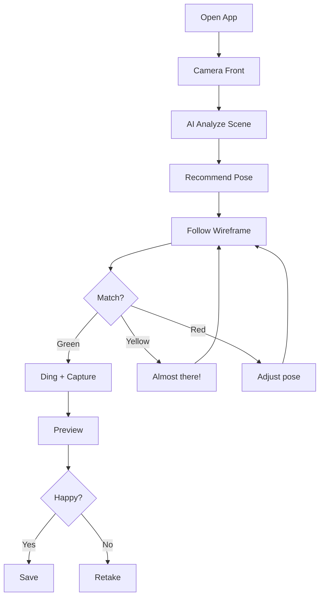

# User Journey Flows

## Journey 1: Solo Selfie (Ping)

**Persona:** Ping (25, Office Worker)
**Scenario:** ถ่าย selfie ที่ event สำหรับ IG Story

**Flow:**

1. Open app → Camera (front) opens immediately
2. AI detects scene → Recommends "Social Media Ready" pose
3. User follows wireframe → Color: Red → Yellow → Green
4. Green match → Ding! + Auto-capture
5. Preview → Save/Retake
6. Save → Back to camera

**Key Moment:** Ding + Green = Delight

## Journey 2: Reluctant Photographer (Joe → Mint)

**Persona:** Joe (21, Student) ถ่ายให้ Mint (แฟน)
**Scenario:** ถ่ายรูปให้ Mint ที่บูธ มีเก้าอี้

**Flow:**

1. Open app → Camera (back) opens
2. AI detects: Chair + 1 Person → Recommends "Confident Sit"
3. Joe sees wireframe → Gives verbal cues to Mint
4. Green match → Ding + Haptic → Mint freezes
5. Auto-capture → Joe shows Mint preview
6. Save → Both happy

**Key Moment:** Dual-channel feedback (Audio + Haptic) bridges Photographer-Subject split

**Subject Feedback:**

- Audio: "Ding!" 🔔 (Mint hears)
- Haptic: Vibration 📳 (Joe's phone, Mint may feel if close)
- Result: Mint knows to freeze without seeing screen

## Journey 3: Override Moment

**Scenario:** AI won't capture but user wants to shoot now

**Flow:**

1. Pose stuck at Yellow for 5+ seconds
2. User taps Manual Shutter (always visible)
3. Instant capture — no confirmation modal
4. Preview → Save/Retake

**Key Principle:** "Override is a feature, not a fallback"

**Design Decisions:**
| Decision | Rationale |
|----------|-----------||
| No confirmation modal | ไม่ทำให้ user รู้สึกว่า "ฝืน" AI |
| Shutter always visible | Not hidden, not dimmed |
| Instant capture | No delay, no judgment |
| Same preview flow | Consistent experience |

## Journey Patterns

**Navigation Patterns:**

- Camera-first (no home screen)
- Single-screen focus
- Preview → Decision loop

**Decision Patterns:**

- AI suggests, User confirms
- Binary post-capture (Save/Retake)
- Implicit continuation (after save, back to camera)

**Feedback Patterns:**

- Color gradient (Red → Yellow → Green)
- Dual-channel for Subject (Audio + Haptic)
- Sequential corrections (one at a time)
- Celebration on success (Ding + Glow + Flash)

---
